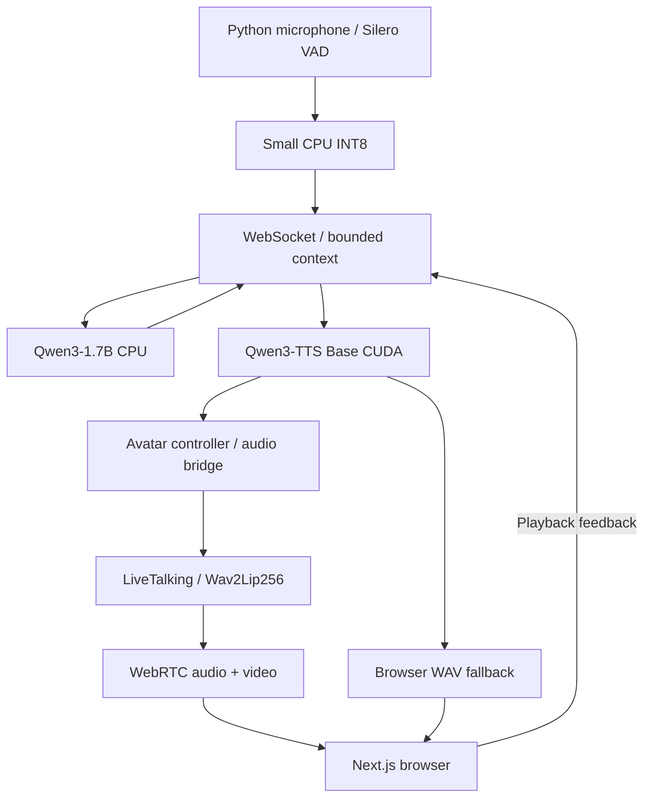

# 本地语音交互AI系统（Local Voice-Interactive AI System）— Architecture

**Stage2C3候选范围：本文保留原完整本地系统的设计及历史事实；公开候选未包含LiveTalking运行树、3项待确认新增或修改补丁，不是完整运行包。** Stage2C1依赖修补保持，但此前的build/audit结果不等于本候选运行验收。Q-001/Q-002 OPEN。见[当前发布门槛](docs/release/PUBLICATION_BLOCKERS.md)。

当前目标架构为Windows Rebuild；以下描述完整本地系统。公开候选保留第一方集成源码但缺少第三方数字人实现，本候选构建、七服务运行和独立恢复未验收。早期Live2D架构另见[历史说明](docs/legacy/demo-stable/architecture.md)。

## 服务与启动顺序

| 顺序 | 服务 | 本地端口 | 资源/职责 |
| --- | --- | ---: | --- |
| 1 | Next.js | 3000 | 生产页面、字幕、用户连接与播放模式 |
| 2 | Avatar控制器 | 8011 | 受控会话、音频提交及WebRTC关联 |
| 3 | Qwen3-TTS 0.6B Base | 8765 | CUDA加载、克隆提示、预热、最终文本合成 |
| 4 | LiveTalking/Wav2Lip256 | 8010 | mel、口型推理、画面融合与WebRTC；25FPS配置 |
| 5 | Qwen3-1.7B Q4_K_M | 8081 | llama.cpp CPU-only、-ngl 0、4096上下文 |
| 6 | Faster-Whisper Small | 8766 | CPU INT8持久STT |
| 7 | WebSocket/Silero VAD | 8767 | Python麦克风采集、状态、上下文与文本链 |

正式入口为Start-Rebuild.cmd/Stop-Rebuild.cmd。首次点击只准备前端/会话，不代替系统服务的预检启动；本轮不运行这些入口。所有服务仅供单用户本机回环使用，WebRTC ICE也由现有入口限制本地地址；没有公网/多租户安全声明。

## 两条播放路径

数字人音轨为默认，WAV备用位于高级设置。音频适配负责既有格式/块边界，不更换TTS声音。播放反馈协调下一次Listening；数字人完成语义包含bounded_media_estimate，不能视为扬声器实录证明。

## 文本、会话与记忆

VAD结束→STT/OpenCC文本→实际LLM请求→候选/必要的一次重试→选择/控制标记清理→历史、字幕与TTS正文。LLM不再承担强制emotion tag输出，neutral仅作接口兼容。普通会话持续到用户结束、连接关闭或不可恢复错误；最近历史/滚动摘要有界，不是无限记忆。

重复保护和摘要存在已知质量边界：重试不是一定消除重复，摘要接受不代表语义永远正确。Q-001/Q-002保持OPEN。quality trace和STT证据默认关闭，诊断不能改变原识别/生成逻辑；取证内容本地受控。

## 安全与失败边界

协调器调用既有服务管理器，逐项preflight/真实READY后登记，持续采样RAM/Commit/分页/GPU并核对归属。PID、原生创建FILETIME、exe、精确命令行、父子树、owner和端口共同验证，不能按进程名或端口空闲推断归属。

| 资源政策 | 现有值/说明 |
| --- | --- |
| 启动RAM | 前端1GiB、控制器0.5GiB、TTS/LiveTalking/1.7B各4GiB、STT/WS各2.5GiB |
| 启动Commit余量 | 同时受对应RAM门槛约束，不只看Available RAM |
| 共同驻留 | 底线1.5GiB、目标2GiB |
| 分页 | 低于目标且持续达到既有页出压力条件时拒绝；具体逻辑以resource-policy.py为准 |
| GPU | TTS/LiveTalking分别保留既有显存门槛5120/2048MiB及采样/异常规则 |
| TTS初始化 | 总600秒优先的分阶段有界等待；真实异常/身份冲突不因有余时而放行 |

失败后只回收本次已核实的自有进程；资料冲突保留证据并拒绝接管。现有恢复规则不能被文档中的状态推测替代。局部异常路径测试和正常停止记录不是全部异常恢复PASS。

## 代码与外部资源

现阶段保持scripts、experiments与third_party路径，避免动态import/身份白名单失效；这些目录含正式运行代码，不因名字有experiments便删除。LiveTalking固定版本和14项本地变更见[UPSTREAM](docs/third-party/EXTERNAL_LIVETALKING.md)。

缺模型、声音参考、预热夹具、Avatar坐标/图像、依赖或构建产物时，本副本不应运行。许可、依赖安全、恢复及隐私门槛详见[发布阻塞](docs/release/PUBLICATION_BLOCKERS.md)，不得通过调整模型/画质或降低阈值掩盖。
