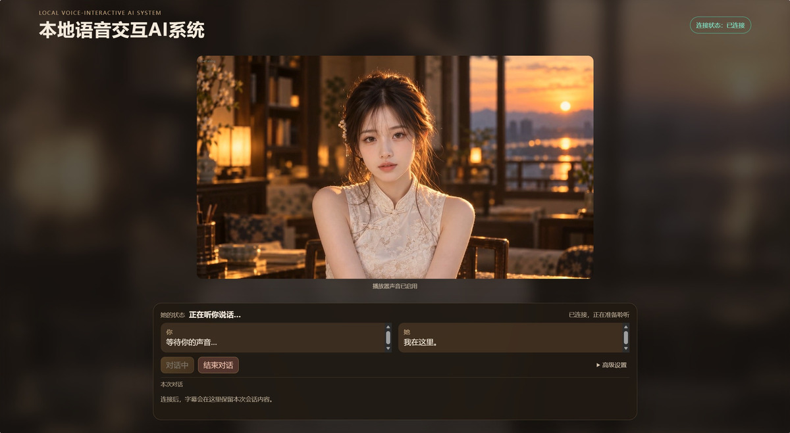
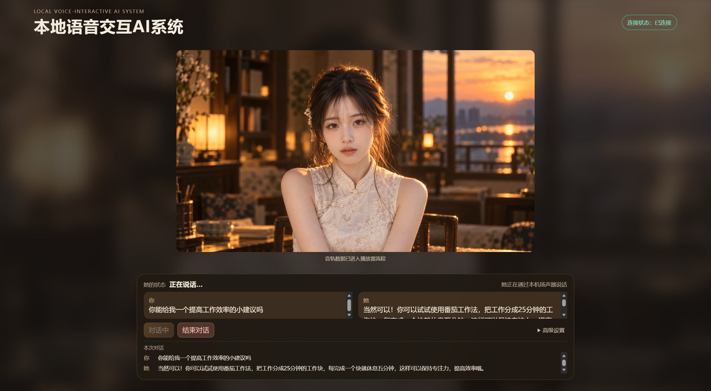
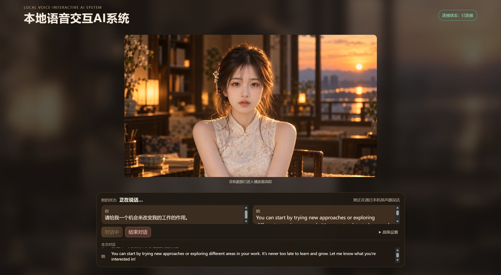
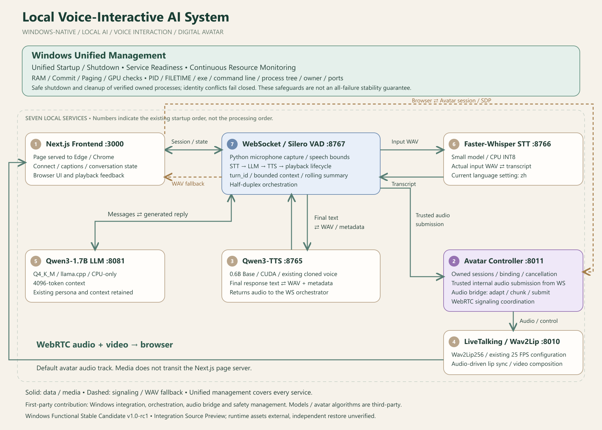

# Local Voice-Interactive AI System

**Windows-Native | Local AI | Voice Interaction | Digital Avatar**

本地语音交互AI系统 · [简体中文](README.zh-CN.md)

## Project overview

An end-to-end, Windows-native AI interaction system that connects microphone input, speech recognition, local language-model inference, cloned-voice synthesis and an audio-driven digital avatar. A browser interface brings the system together through live conversation states, captions and WebRTC audio/video.

The first-party engineering work is the integration: coordinating seven persistent services, bridging generated speech into the avatar pipeline, and managing process ownership and resource limits on a 16 GB laptop. The underlying models and avatar algorithms are third-party components.

> **Repository scope: Integration Source Preview.** This repository contains selected integration source and documentation, not a complete, clone-and-run seven-service package. The screenshots show the original local system. The baseline is **Windows Functional Stable Candidate v1.0-rc1**.

## Main showcase

*S1 — The actual local interface before connection. Click any screenshot to inspect the full-size image.*

This showcase uses six real screenshots, architecture diagrams and engineering documentation.

## Key features

- **Local voice interaction:** Python microphone capture and Silero VAD define utterances and drive an explicit half-duplex conversation lifecycle.
- **Speech recognition:** persistent Faster-Whisper Small on CPU INT8.
- **Local LLM inference:** Qwen3-1.7B-Q4_K_M through llama.cpp, CPU-only with a 4096-token context.
- **Speech synthesis:** Qwen3-TTS 0.6B Base on CUDA with the existing user-approved cloned voice.
- **Digital avatar and WebRTC:** an Avatar Controller bridges generated audio into LiveTalking / Wav2Lip256 for audio-driven lip sync and browser audio/video delivery.
- **Multi-turn conversation:** one click connects and starts a session; the user ends it explicitly. Context remains bounded through recent history and rolling summaries.
- **Multilingual voice interaction — experimental:** user-reported English speech-input tests produced visible English replies; language accuracy remains under evaluation.
- **Browser WAV fallback:** retained as an alternative playback mode inside advanced settings.
- **Unified Windows management:** per-service readiness, resource checks, continuous monitoring and strict ownership checks support controlled startup and cleanup.

## Real system screenshots

These are selected moments from real local use, not a reconstructed UI, a continuous-session recording or a frame-rate benchmark. The interface remains Chinese in both README languages.

| S2 — Voice listening | S3 — Chinese voice interaction |
| --- | --- |
|  |  |
| Connected and ready for speech. | User transcript, assistant text and Speaking state. |

S4 — Further Chinese conversation

A further Chinese interaction shows a concrete productivity suggestion.

## Multilingual voice interaction — experimental

The screenshots show English replies from user-reported English speech-input tests. This interaction capability remains experimental.

| S5 — English response I | S6 — English response II |
| --- | --- |
|  |  |

## Seven-service architecture

Click the diagram to view the full-resolution SVG. [Editable Mermaid source](assets/architecture/SEVEN_SERVICE_ARCHITECTURE_EN.mmd).

The WebSocket service calls STT, LLM and TTS. Synthesized audio returns to the orchestrator, then travels through the trusted Avatar audio bridge to LiveTalking / Wav2Lip. WebRTC sends audio and video directly to the browser; the Next.js page server is not a media relay. Browser WAV delivery remains a separate fallback.

| Startup order | Service | Loopback port | Responsibility |
| --- | --- | ---: | --- |
| 1 | Next.js Frontend | 3000 | Interface, captions, state and playback controls |
| 2 | Avatar Controller | 8011 | Session binding, audio adaptation/submission and signaling |
| 3 | Qwen3-TTS | 8765 | CUDA voice synthesis with the existing clone prompt |
| 4 | LiveTalking / Wav2Lip256 | 8010 | Audio-driven video avatar and WebRTC output |
| 5 | Qwen3-1.7B / llama.cpp | 8081 | CPU-only text generation |
| 6 | Faster-Whisper Small | 8766 | Persistent CPU INT8 speech recognition |
| 7 | WebSocket / Silero VAD | 8767 | Microphone input, turn lifecycle and conversation orchestration |

## Technology stack

| Layer | Technology | Role |
| --- | --- | --- |
| Services and integration | Python, HTTP, WebSocket | Explicit service boundaries and event-driven orchestration |
| Browser interface | Next.js, TypeScript | One-click session control, state, captions and playback |
| Speech input | Silero VAD, Faster-Whisper Small | Speech boundaries and utterance transcription |
| Local reasoning | Qwen3-1.7B-Q4_K_M, llama.cpp | Local CPU inference |
| Speech output | Qwen3-TTS 0.6B Base | GPU synthesis with approved cloned-voice output |
| Digital avatar | LiveTalking, Wav2Lip256 | External audio ingestion, lip sync and video composition |
| Media transport | WebRTC; Browser WAV fallback | Default avatar audio/video and alternative browser audio |

## Engineering highlights

- **Native Windows integration:** seven services share an explicit startup, readiness, supervision and shutdown lifecycle without WSL or Docker.
- **Resource-aware model placement:** CPU INT8 STT and a CPU-only 1.7B LLM leave GPU capacity for TTS and Wav2Lip. This is a measured target-device trade-off, not a claim that memory constraints disappear.
- **Strict process ownership:** PID, native creation FILETIME, executable path, command line, parent/child tree, owner records and ports are checked together. Unknown identities fail closed.
- **Resource supervision:** Available RAM, committed-memory headroom, paging pressure and whole-GPU usage are monitored. Cleanup targets verified processes owned by the current run.
- **Observable voice orchestration:** Listening → Transcribing → Thinking → Synthesizing → Speaking → Listening, with turn identifiers and playback feedback.
- **Audio bridge engineering:** controlled binding, adaptation and delivery connect a separate TTS service to the video-avatar pipeline while preserving the WAV fallback.
- **Bounded validation:** offline contracts, real service readiness and user-operated conversations are recorded as separate evidence layers.

WebRTC streams media; recognition, text generation and synthesis are coordinated per utterance. The system does not claim full-duplex interruption, token-streaming speech generation, unlimited memory or guaranteed recovery from every failure.

## Development and validation

| Evidence layer | What has been established | Boundary |
| --- | --- | --- |
| Original local system | User-confirmed seven-service startup, first-click connection, continuous eight-turn avatar interaction, manual ending, WAV fallback and safe shutdown | Functional acceptance, not complete conversational quality or long-term stability |
| Public source candidate | Dependency installation with lifecycle scripts disabled; full/production npm audit queries found zero known vulnerable package groups at that time; ESLint, TypeScript noEmit and Webpack production build passed | Frontend-only evidence; the existing ESLint unsupported-version warning remains; no permanent zero-risk claim |
| Showcase title alignment | Two display strings synchronized with the local screenshots; TypeScript, targeted ESLint and Webpack production build passed | Display text only; no interaction, model or safety-policy changes |
| Current showcase | Six real screenshots and editable architecture diagrams | Static images do not prove actual FPS, sound quality, synchronization or session continuity |
| Still unverified | Public-clone seven-service runtime, complete independent restore, long-term stability and comprehensive abnormal recovery | No PASS claim |

The working integration source also includes a default-off STT evidence patch added after the frozen rc1 ZIP; the source preview and current local showcase are not byte-identical reproductions of that archive.

### Seven Development Phases

1. **Phase 1 — Environment and Model Validation:** establish Windows-native feasibility and validate STT, TTS and LLM components.
2. **Phase 2 — Voice Interaction Pipeline:** connect VAD, persistent speech services and explicit half-duplex turns.
3. **Phase 3 — Early Digital Avatar Integration:** combine WebSocket, Next.js, Browser Audio and Live2D/RMS lip sync.
4. **Phase 4 — Demo Stable Validation:** validate the production frontend, 1/2/6-turn flows, launchers and source-package boundaries.
5. **Phase 5 — Windows Rebuild Architecture Decision:** retain a successful baseline while choosing an audio-driven video-avatar route.
6. **Phase 6 — Windows Rebuild Implementation:** implement the Avatar bridge, WebRTC, seven-service supervision and product interaction flow.
7. **Phase 7 — Functional Acceptance and Quality Investigation:** freeze the functional candidate and collect bounded validation evidence.

See the [complete development log](https://github.com/edliu077/Local-Voice-Interactive-AI-System/blob/main/DEVELOPMENT_LOG.md), [Demo Stable history](https://github.com/edliu077/Local-Voice-Interactive-AI-System/blob/main/docs/legacy/demo-stable/README.md) and [Why Windows Rebuild](https://github.com/edliu077/Local-Voice-Interactive-AI-System/blob/main/docs/architecture/WHY_WINDOWS_REBUILD.md). The original seven Git commits are preserved; earlier Demo Stable work remains a successful functional foundation.

## Hardware and runtime constraints

The target device is a Windows laptop with **16 GB RAM and an NVIDIA GeForce RTX 4060 Laptop GPU with 8 GB VRAM**. The LLM is CPU-only; STT uses CPU INT8; TTS and Wav2Lip use the GPU. Wav2Lip256 retains its 25 FPS configuration, which is not a guarantee of sustained measured output.

The full resident stack has limited headroom. Additional recording software was not stable within the available memory budget, so this portfolio uses real screenshots, diagrams and engineering notes; no public video demo is provided. Existing RAM, Commit, paging and GPU protections remain in place.

## Public repository scope

This is an **Integration Source Preview**, not a complete runnable distribution. It retains selected first-party integration, service managers, frontend, configuration examples and technical history. It excludes the complete LiveTalking vendor tree and unresolved derivatives/patches, model weights, binaries, Python environments, private reference audio/text, voice artifacts and Avatar source/derived media needed for restoration.

The screenshots document the original local system; they do not restore those missing runtime assets. The retained Start-Rebuild.cmd / Stop-Rebuild.cmd entry points describe the local system's managed lifecycle, not a clone-and-run promise. Independent restoration remains unverified.

Project-demo display permission does not grant redistribution of models, private reference voices or third-party code. Existing copyright and component terms remain unchanged.

## Documentation

[Architecture](https://github.com/edliu077/Local-Voice-Interactive-AI-System/blob/main/ARCHITECTURE.md) · [Validation boundaries](https://github.com/edliu077/Local-Voice-Interactive-AI-System/blob/main/docs/validation.md) · [Changelog](https://github.com/edliu077/Local-Voice-Interactive-AI-System/blob/main/CHANGELOG.md) · [Roadmap](https://github.com/edliu077/Local-Voice-Interactive-AI-System/blob/main/ROADMAP.md) 
[Windows setup and restoration](https://github.com/edliu077/Local-Voice-Interactive-AI-System/blob/main/docs/windows-setup.md) · [External models and assets](https://github.com/edliu077/Local-Voice-Interactive-AI-System/blob/main/docs/model-downloads.md) · [Privacy](https://github.com/edliu077/Local-Voice-Interactive-AI-System/blob/main/docs/privacy.md) 
[Third-party notices](https://github.com/edliu077/Local-Voice-Interactive-AI-System/blob/main/THIRD_PARTY_NOTICES.md) · [External LiveTalking boundary](https://github.com/edliu077/Local-Voice-Interactive-AI-System/blob/main/docs/third-party/EXTERNAL_LIVETALKING.md) · [Publication gates](https://github.com/edliu077/Local-Voice-Interactive-AI-System/blob/main/docs/release/PUBLICATION_BLOCKERS.md) · [Audited source file list](https://github.com/edliu077/Local-Voice-Interactive-AI-System/blob/main/docs/release/PUBLICATION_FILE_LIST.md)

Copyright © 2026 Enhua Liu. Original source and documentation retain their existing all-rights-reserved terms; third-party models, software and assets retain their own conditions. No new permissive license is granted by this showcase.

**[阅读简体中文版本](README.zh-CN.md)**
