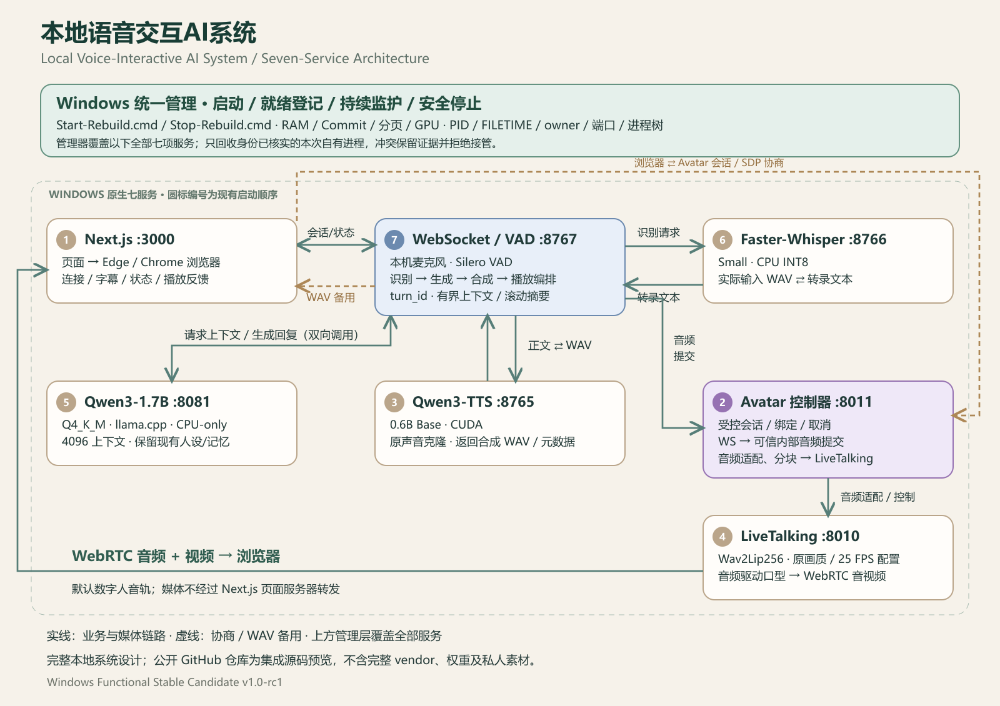

# 本地语音交互AI系统

**Windows 原生 | 本地 AI | 语音交互 | 数字人**

Local Voice-Interactive AI System · [English](README.md)

## 项目概览

本项目在 Windows 本机串联麦克风输入、语音识别、本地语言模型、声音克隆合成及音频驱动数字人。浏览器通过连接状态、字幕、对话控制及 WebRTC 音视频，提供完整的交互入口。

第一方工程重点是集成：协调七项持久服务，将独立 TTS 的语音送入数字人链路，并在 16GB 内存设备上管理进程归属与资源边界。底层模型及数字人算法来自第三方组件。

> **公开范围：Integration Source Preview（集成源码预览）。** 仓库提供经过筛选的集成源码和文档，不是克隆后即可运行的完整七服务包。截图来自原完整本地系统。基线为 **Windows Functional Stable Candidate v1.0-rc1**。

## 实际界面

*S1 — 连接前的真实本地界面。点击任意截图可查看原尺寸图片。*

本页以六张真实截图、架构图和技术说明展示工程成果。

## 核心功能

- **本地语音交互：** Python 麦克风采集及 Silero VAD 划分语句，采用明确的半双工听说流程。
- **语音识别：** Faster-Whisper Small 持久服务，CPU INT8。
- **本地文本生成：** Qwen3-1.7B-Q4_K_M，经 llama.cpp CPU-only 推理，4096 上下文。
- **语音合成：** Qwen3-TTS 0.6B Base CUDA，保留用户批准的克隆声音输出。
- **数字人与 WebRTC：** Avatar 控制器将合成语音桥接至 LiveTalking / Wav2Lip256，输出音频驱动口型和浏览器音视频。
- **多轮对话：** 一次点击连接并开始，用户主动结束；最近历史及滚动摘要保持上下文有界。
- **多语言语音交互 — 实验性：** 用户报告的英语语音输入测试中出现了英文回复，语言准确率仍待验证。
- **浏览器 WAV 回退：** 保留在高级设置中的备用播放方式。
- **Windows 统一管理：** 服务就绪、资源预检、持续监护、进程归属核验及安全回收。

## 真实系统截图

以下是本地实际使用时的独立画面，不是重绘界面、连续会话录像或帧率基准。中英文 README 均保留真实中文 UI。

| S2 — 正在聆听 | S3 — 中文语音交互 |
| --- | --- |
|  |  |
| 已连接，等待用户说话。 | 用户转录、助手文本与 Speaking 状态。 |

S4 — 后续中文对话

后续中文问答展示具体的工作效率建议。

## 多语言语音交互 — 实验性

以下截图展示用户报告使用英语语音输入测试时的英文回复，该交互能力仍为实验性。

| S5 — 英文回复 I | S6 — 英文回复 II |
| --- | --- |
|  |  |

## 七服务系统架构

点击架构图查看完整SVG高清版本。[可编辑 Mermaid 源码](assets/architecture/SEVEN_SERVICE_ARCHITECTURE.mmd)。

WebSocket 服务调用 STT、LLM 和 TTS；合成音频先返回编排层，再经受信任的 Avatar 音频桥提交 LiveTalking / Wav2Lip。WebRTC 音视频直接送达浏览器，不由 Next.js 页面服务器转发。浏览器 WAV 是独立备用路径。

| 启动顺序 | 服务 | 本机回环端口 | 职责 |
| --- | --- | ---: | --- |
| 1 | Next.js 前端 | 3000 | 界面、字幕、状态及播放控制 |
| 2 | Avatar 控制器 | 8011 | 会话绑定、音频适配/提交与协商 |
| 3 | Qwen3-TTS | 8765 | 保留原声音克隆的 CUDA 语音合成 |
| 4 | LiveTalking / Wav2Lip256 | 8010 | 音频驱动视频数字人与 WebRTC 输出 |
| 5 | Qwen3-1.7B / llama.cpp | 8081 | CPU-only 文本生成 |
| 6 | Faster-Whisper Small | 8766 | CPU INT8 持久语音识别 |
| 7 | WebSocket / Silero VAD | 8767 | 麦克风、轮次生命周期与对话编排 |

## 技术栈

| 层次 | 技术 | 作用 |
| --- | --- | --- |
| 服务与集成 | Python、HTTP、WebSocket | 明确服务边界，按事件编排 |
| 浏览器界面 | Next.js、TypeScript | 一次点击会话控制、状态、字幕及播放 |
| 语音输入 | Silero VAD、Faster-Whisper Small | 语音边界与语句转录 |
| 本地生成 | Qwen3-1.7B-Q4_K_M、llama.cpp | 本地 CPU 推理 |
| 语音输出 | Qwen3-TTS 0.6B Base | GPU 合成及获批克隆声音输出 |
| 数字人 | LiveTalking、Wav2Lip256 | 外部音频输入、口型与视频融合 |
| 媒体传输 | WebRTC、Browser WAV 回退 | 默认数字人音视频及备用浏览器音频 |

## 工程亮点

- **Windows 原生集成：** 七服务共享启动、就绪、监督与停止生命周期，不依赖 WSL 或 Docker。
- **受资源约束的模型部署：** Small CPU INT8 和 CPU-only 1.7B 为 GPU 上的 TTS、Wav2Lip 留出空间；这是目标设备的工程取舍，不意味着内存约束消失。
- **严格进程归属：** PID、原生创建 FILETIME、exe、完整命令行、父子树、owner 与端口联合验证；未知身份继续安全拒绝。
- **持续资源监护：** 观察 Available RAM、Commit 余量、分页压力与整卡显存，仅回收本次已验证的自有进程。
- **可观察的语音编排：** Listening → Transcribing → Thinking → Synthesizing → Speaking → Listening，关联 turn_id 和播放反馈。
- **Avatar 音频桥：** 受控绑定、适配和交付连接独立 TTS 与视频数字人，保留 WAV 回退能力。
- **有边界的验收：** 离线契约、真实服务 READY 与人工对话是不同证据层级，分别记录。

WebRTC 传输连续媒体，识别、文本生成和合成则按语句编排。不宣称全双工打断、逐 token 流式语音生成、无限记忆或所有异常下的恢复保证。

## 开发与验证

| 证据层次 | 已确认内容 | 边界 |
| --- | --- | --- |
| 原完整本地系统 | 用户确认七服务、首次点击、数字人连续八轮、主动结束、WAV 回退、安全关闭 | 功能验收，不等于完整对话质量或长期稳定性 |
| 公开源码候选 | 禁用生命周期脚本的依赖安装；当次完整/生产 npm 审计均为0个已知漏洞包组；ESLint、TypeScript noEmit、Webpack 生产构建通过 | 仅前端证据；ESLint 停止支持警告仍保留，不保证永久零风险 |
| 展示标题同步 | 两处文案与本地截图对齐，TypeScript、定向 ESLint 与 Webpack 生产构建通过 | 仅展示文字，不改变交互、模型或安全策略 |
| 当前展示素材 | 六张真实截图及可编辑架构图 | 静态图片不证明实际 FPS、声音质量、同步或同会话连续性 |
| 未验收 | 公开克隆七服务运行、完整独立恢复、长期稳定性及全面异常恢复 | 不标记 PASS |

公开工作源码还含冻结后默认关闭的 STT 取证补丁；集成源码预览及当前本地展示版本均不是冻结 rc1 ZIP 的逐字节副本。

### 七个开发阶段

1. **Phase 1 — Environment and Model Validation：** Windows 原生可行性及 STT/TTS/LLM 逐组件验证。
2. **Phase 2 — Voice Interaction Pipeline：** VAD、持久服务及明确的半双工轮次。
3. **Phase 3 — Early Digital Avatar Integration：** WebSocket、Next.js、Browser Audio、Live2D/RMS 口型。
4. **Phase 4 — Demo Stable Validation：** 生产前端、1/2/6轮流程、启动器及源码包边界。
5. **Phase 5 — Windows Rebuild Architecture Decision：** 保留有效基线，选择音频驱动视频数字人路线。
6. **Phase 6 — Windows Rebuild Implementation：** Avatar 桥、WebRTC、七服务监护及产品化操作。
7. **Phase 7 — Functional Acceptance and Quality Investigation：** 功能候选冻结及有边界的验收取证。

[完整开发日志](https://github.com/edliu077/Local-Voice-Interactive-AI-System/blob/main/DEVELOPMENT_LOG.md)、[Demo Stable历史](https://github.com/edliu077/Local-Voice-Interactive-AI-System/blob/main/docs/legacy/demo-stable/README.md)、[为什么采用Windows Rebuild](https://github.com/edliu077/Local-Voice-Interactive-AI-System/blob/main/docs/architecture/WHY_WINDOWS_REBUILD.md)。原七次 Git 提交及历史完整保留，早期 Demo Stable 是后续工程的有效功能基础。

## 硬件与运行约束

目标设备为 **16GB RAM、NVIDIA GeForce RTX 4060 Laptop GPU 8GB VRAM 的 Windows 笔记本**。LLM 为 CPU-only，STT 为 CPU INT8，TTS 与 Wav2Lip 使用 GPU。Wav2Lip256 保留25FPS配置，这不是持续实测输出帧率保证。

全系统共同驻留的内存余量有限。额外录屏软件在现有预算下不能稳定运行，因此作品集采用真实截图、架构图和工程说明，不提供公开视频 Demo。RAM、Commit、分页与 GPU 保护均保留。

## 公开仓库范围

本仓库是 **Integration Source Preview**，不是完整运行发行包。保留经过选择的第一方集成、服务管理器、前端、配置示例与技术历史；不包含完整 LiveTalking vendor 树及未解决的派生实现/补丁、模型权重、二进制、Python 环境、私人声音参考/文本/声音制品，以及恢复所需的 Avatar 源素材与派生数据。

截图记录原本地系统，不会补齐上述运行资产。保留的 Start-Rebuild.cmd / Stop-Rebuild.cmd 表达本地受控生命周期，不代表克隆即运行。独立恢复仍未验收。

项目演示展示授权不等于模型、私人参考声音或第三方源码的再分发授权；既有版权及各组件条款不变。

## 技术文档

[架构](https://github.com/edliu077/Local-Voice-Interactive-AI-System/blob/main/ARCHITECTURE.md) · [验收边界](https://github.com/edliu077/Local-Voice-Interactive-AI-System/blob/main/docs/validation.md) · [变更日志](https://github.com/edliu077/Local-Voice-Interactive-AI-System/blob/main/CHANGELOG.md) · [路线图](https://github.com/edliu077/Local-Voice-Interactive-AI-System/blob/main/ROADMAP.md) 
[Windows准备与恢复](https://github.com/edliu077/Local-Voice-Interactive-AI-System/blob/main/docs/windows-setup.md) · [模型与外置资产](https://github.com/edliu077/Local-Voice-Interactive-AI-System/blob/main/docs/model-downloads.md) · [隐私](https://github.com/edliu077/Local-Voice-Interactive-AI-System/blob/main/docs/privacy.md) 
[第三方声明](https://github.com/edliu077/Local-Voice-Interactive-AI-System/blob/main/THIRD_PARTY_NOTICES.md) · [外部LiveTalking集成边界](https://github.com/edliu077/Local-Voice-Interactive-AI-System/blob/main/docs/third-party/EXTERNAL_LIVETALKING.md) · [发布门槛](https://github.com/edliu077/Local-Voice-Interactive-AI-System/blob/main/docs/release/PUBLICATION_BLOCKERS.md) · [已审核源码清单](https://github.com/edliu077/Local-Voice-Interactive-AI-System/blob/main/docs/release/PUBLICATION_FILE_LIST.md)

原创源码及文档继续 Copyright © 2026 Enhua Liu，保留既有 All rights reserved 条款；第三方模型、软件和素材遵循各自条件。本展示不授予新的宽松许可。

**[Read the English version](README.md)**
