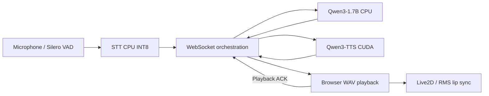

# 本地语音交互AI系统（Local Voice-Interactive AI System）— Demo Stable架构

本文描述早期Demo Stable v0.9，依据固定提交3bacd16的[架构原件](https://github.com/edliu077/Local-Voice-Interactive-AI-System/blob/3bacd16bf2b647bf7ace0fb0d05450d1f205219f/ARCHITECTURE.md)。不要将这里的旧端口和启动入口套用到Windows Rebuild。

## Phase 1 — Environment and Model Validation

目标为单用户Windows 11本机运行，服务绑定127.0.0.1，不以WSL、Docker或公网服务为前提。模型逐个验证后再组合，CPU/GPU分工围绕目标设备的16GB RAM和8GB VRAM确定。

| 模块 | 早期稳定实现 | 接口/职责 |
| --- | --- | --- |
| VAD | Silero，CPU | Python麦克风采集与端点检测 |
| STT | Faster-Whisper Small，CPU INT8 | 本地HTTP，8766 |
| LLM | Qwen3-1.7B Q4_K_M，llama.cpp，-ngl 0 | OpenAI兼容HTTP，**旧端口8080** |
| TTS | Qwen3-TTS 0.6B Base，CUDA声音克隆 | 本地HTTP，8765 |
| 编排 | Python WebSocket | 8767，单一活动会话 |
| 页面 | Next.js生产构建、React、TypeScript | 3000 |
| 数字人 | PixiJS + Live2D | 浏览器渲染 |
| 口型 | Web Audio analyser RMS | 驱动ParamMouthOpenY，非音素/视素对齐 |

## Phase 2 — Voice Interaction Pipeline

STT和TTS持久服务减少逐轮加载。单轮状态为Listening → Transcribing → Thinking → Synthesizing → Speaking，播放结束后再Listening。正常会话也可因用户停止或有限轮数结束；1/2/6轮为当时验收范围。

麦克风由Python采集，不是浏览器录音；采集在识别前结束，助手播放期间不打开麦克风。该半双工设计不支持边说边打断助手，不把此边界写成异常。

## Phase 3 — Early Digital Avatar Integration

编排器向浏览器发送音频元数据及二进制WAV；浏览器校验、解码、播放，并回传playback-started/finished等控制消息。最终播放音频经Web Audio分析得到RMS，用于口型平滑和归零，而不是从文字估算嘴型。

Live2D负责EyeBlink、Physics、Breath等渲染表现。它避免新增视频推理负载，为CUDA TTS保留资源；这是当时主动选择的有效轻量方案，不能因后续采用Wav2Lip而贬低。

协议的准确字段以对应旧提交源码为准。内部/历史兼容标识不在文档整理时改名。

## Phase 4 — Demo Stable Validation

生产前端使用next build --webpack与next start。旧统一启动顺序为LLM → STT → TTS → WebSocket → Frontend；TTS必须真实健康就绪，不能只看PID存在。启动器核对监听者及项目进程，未知端口占用拒绝接管，停止器只处理经核实的项目实例。

这些是旧管理规则，不与Rebuild的PID/原生FILETIME/完整命令行/owner等更细规则混为一谈。早期代码保留在原Git树，本次不创建另一套新版七服务入口。

## 非目标与安全边界

旧基线不承诺长期记忆、J2有界上下文、自动情绪映射、4B正式运行、实时视频数字人、全双工、远程多用户或生产认证。回环绑定降低网络暴露，不等于抵御恶意本机进程的完整安全体系。

权重、llama.cpp程序、Live2D/Cubism素材及私人声音参考外置。源码和依赖许可证不自动授予这些资产的复制传播权。详见[早期限制](known-issues.md)。
